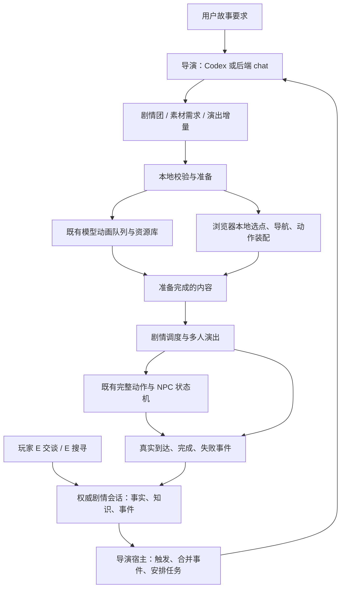

# Lifetime：提前量叙事、外部导演与游戏验证方案

记录日期：2026-10-15。用途：汇总本次讨论、代码审阅和联网资料，供其他 Codex 窗口直接理解项目方向并据此开展后续实施。

**本文是研究与实施建议，不是已完成能力清单。本次只新增本文件，不修改代码、不修改 AGENTS.md、不启动素材生成。** 下述工具名、数据类型和里程碑中标为“建议”的内容均待实现。代码状态以本次只读审阅为准，后续窗口应重新检查正在变化的工作区。

## 1. 已形成的方向与核心判断

继续基于 Lifetime 做“玩家驱动、AI 参与制作与推进的剧情演出游戏”。Lifetime 已有的演员、动画、完整动作、地图和演出执行能力是基础，不需要丢弃或迁移到 Voxel Engine。

根据用户实际测试，导师的 Voxel Engine 当前更偏向 UGC、玩法生成和工具调用，剧情表现与 NPC 剧情状态相对薄弱。这是本次选择切入点的依据，不能据此断言对方永远不会做叙事，或双方底层能力完全不重合。模型生成、动画、寻路、状态机等通用能力存在重合是正常的。

Lifetime 接下来应回答一个更具体的问题：

> 玩家做过的一件事，怎样成为后续事件的原因，并被提前准备成角色能够在真实场景中演出来的事情，让玩家清楚看见自己的影响？

项目价值来自这一完整体验及其可靠性，而不只是多做几个 NPC 状态，或再包装一遍模型生成接口。

用户本轮提出的目标包括：

1. 导演能够规划剧情框架与局部内容，复用或生成模型、动画，建立 NPC 活动和状态，并根据玩家事件修改后续内容。
2. 用户给出基本需求后，自动准备第一幕所需的玩家、基础动作、必要 NPC 和小动物。
3. 玩家游玩后，游戏继续发生由这些行为引起的变化。
4. 第一版交互限制为 **E 交谈、E 搜寻**；对话中的明确选项属于这个交互范围。
5. 导演可以由用户自己的 Codex 承担，也可以使用后端 chat。两者共用 Lifetime 能力，不要求把全部智能写进网页。
6. 先构思游戏体验，再让 Codex 尝试实现；从真实失败、耗时和重复劳动中提炼专用工具。

这已经足够确定第一轮实验，但尚未覆盖全部工程问题：还需要明确事实与知识、事件记录、异步准备、演出完成确认、运行中增量更新，以及谁来持续唤起导演。本文补齐这些边界。

## 2. 老师的意思，以及“先让 Codex 做”的正确工作形式

原始资料：[组会转录](C:/Users/yafo777/.codex/attachments/06a9ef38-9e21-4055-a562-358bb8e35bf9/已粘贴的文本.txt)。转录存在识别错误，以下按时间和上下文归纳，不将口误视为严格需求。

| 时间 | 老师的表达 | 对项目的含义 |
| --- | --- | --- |
| 00:51–01:35 | 根据玩家做过的事，提前准备后面的故事；玩家到场时，两个人可能已经在吵架 | 准备应早于体验需求，而不是玩家等着模型写完 |
| 02:06–03:55 | 大纲需要一场争执；具体可变成争抢玩家之前种下的苹果，并在玩家面前演出来 | 固定戏剧目的，具体原因和表现可由玩家历史实例化 |
| 06:28–07:57 | 玩家期待自己的行为带来后续；大量无关 AI 居民会稀释影响 | 聚焦少量与玩家有关的角色和可见后果 |
| 10:08–10:13 | 先做“大宅门”游戏，做几个叙事和运镜切片 | 先有可玩的具体作品，避免先造无限通用平台 |
| 10:32–11:06 | 强 AI 可能可以完成但很慢；抽取其过程，形成更高效的 harness | 从成功轨迹与失败修复中提炼上下文、工具和检查器 |
| 12:26–12:53 | 通过实际游戏判断工具需要什么能力 | 每一项工具扩展都应对应游戏中的真实需求 |

因此可以先让 Codex 充当制作人、编剧和导演，使用现有能力完成一小段游戏。把过程中的问题留下记录，例如“角色不知道谁已经听过秘密”“争执写完了但演员无法同时到位”“场面来不及准备”。

随后判断问题属于内容设计、接口缺失、执行失败、模型推理还是延迟成本，再集中解决。**并非任何一次 AI 失败都自动成为研究贡献**；值得投入的是可复现、影响体验、现有方法不足，且能够用实验检验改进的问题。

## 3. 如何精确定义“提前量叙事”

建议保留这个项目名称，但把它拆成两个可验证的维度：

- **因果维度**：玩家已经发生的行动，改变后续事件的原因、参与者、信息分布、角色行为或可达结果。
- **时间维度**：在玩家需要体验这些后果之前，系统已准备好足够的内容、素材和演出条件。

只根据选择现场续写一段文字，具备前一维度的可能性，但未必具备提前准备。后台预生成很多故事，如果和玩家无关，也没有实现因果维度。

建议操作性定义：

> 提前量叙事是在保留已确认事实和玩家能动性的前提下，根据玩家事件与当前世界状态，有限地推演并准备近期可能发生的剧情；在条件满足时执行，并让实际发生的后果可追溯、可感知。

这里不要求准确预测玩家。预测只帮助安排准备工作，不能成为强迫玩家走某条路线的理由。玩家可以提前到场、改口、离开、跳过和打断。

也不要求“所有后续都由玩家决定”。角色可以有独立动机和时间压力，但应清楚区分哪些变化来自玩家，哪些来自世界自身。

### 3.1 什么才算可见影响

同一开场下，两种选择至少应改变一种实际内容：

- 谁去找谁，谁留在原地，谁回避玩家。
- 谁知道某个事实，因而能说或不能说某句话。
- 哪个地点出现一场对质，哪些人物参加。
- 某次搜寻是否可进行、能够获得何种线索。
- 信任、承诺、可交谈话题和后续机会。
- 事件解决的方式，或者后续剧情团的进入条件。

只把玩家说过的话插入台词，而角色行动和可选结果完全相同，只能证明文本呼应，不能充分证明剧情被改变。

### 3.2 三条必须区分的状态线

1. **内容准备**：草案 → 校验 → 准备完成 → 失效或被采用。
2. **实际演出**：等待条件 → 执行中 → 完成、被打断或失败。
3. **玩家获知**：尚未看见 → 看见部分 → 获知某项信息。

不能把“故事写好了”当作“事情发生了”，也不能把“事情发生了”当作“玩家或所有 NPC 都知道了”。

## 4. 终极形态，以及用来验证它的第一个游戏

### 4.1 目标体验

用户描述一个故事种子，例如：

> 我来到一座园林宅院。两个家人因为一封来信互相怀疑。我能调查、交谈；我把消息告诉谁，会改变他们之后去找谁、相信谁以及发生什么。

系统读取真实地图与素材能力，形成若干剧情团、人物动机及初始事实，准备第一幕。玩家进入，NPC 已经在做有意义的事情。玩家 E 搜寻、E 交谈，系统记录实际结果，导演利用玩家继续走动和探索的时间准备下一场。

之后，玩家在地图中看见由自己先前选择引发的对质、解释或回避；再次介入又影响后续。演出中应有站位、朝向、停顿、回应和行动，而不只是弹出文字框。

最终可扩展到更多剧情团、更多角色和较长记忆；首个实验只验证两次连续的“行动 → 后果”。

### 4.2 建议第一切片：《园林里的来信》

这是建议样本，不是用户已经指定的正式故事，也不表示现有地图具备下列全部地点。地点必须映射到实际地图的可达区域。

- 一张已导入地图，优先使用当前正常可运行的园林。
- 一个可操作玩家、两名主要 NPC；第三名只在确有戏剧作用时加入。
- 一只小动物，用于验证开场自动装配和日常活动；它可以背景活动，不能因为“AI 世界”就加入大量角色。首轮交互联调可用已有资源，完整目标仍包含按需求复用或生成小动物。
- 一个可搜寻点：玩家发现一封来信或其线索。
- 一次关键交谈：告诉甲、告诉乙，或暂时隐瞒。
- 一个后续场面：对质、私下解释，或误会继续发展。
- 一次第二轮介入：出示信息、澄清传话范围或拒绝介入，产生一个可见收束。
- 体验长度暂定约 10–15 分钟，作为设计目标，不是生成速度或开发工期承诺。

示例中的“告诉甲”只更新甲的知识。乙如果后来得知，需要由真实交谈、目击或其他已定义渠道解释。玩家暂时隐瞒时，不能偷偷让两人读取玩家搜寻结果。

两条路线都应有完整体验。故事可以绕开一场原计划争执；“必须完成所有剧情团”不应压倒玩家已经改变的局势。

第一幕的“基础地”目前解释为**在已有地图上装配场景**。地图生成、建筑编辑和渲染方案生成不因这一目标自动进入范围。

## 5. 剧情团：大纲约束与局部自由怎样共存

用户原来的“团状设计”可以对应 storylets 或较大的剧情模块：先约束目标与关系，再根据当前状态生成局部场面。

建议一个剧情团包含：

| 内容 | 例子 |
| --- | --- |
| 戏剧目的 | 让玩家认识到传话会改变两个人的关系 |
| 进入条件 | 玩家获得线索，或某人的等待期限到达 |
| 角色动机 | 甲想隐藏失误；乙想确认自己是否被欺骗 |
| 固定约束 | 来信已确认的内容不变；乙尚不知道玩家的发现 |
| 可变内容 | 对质原因、发起者、地点、台词、出场顺序 |
| 允许结果 | 解释、误会加深、暂时合作、事件被玩家绕开 |
| 资源需要 | 两名角色、走路与基础表达动作、两个可达站位 |
| 演出与退出 | 会合、交谈、玩家介入窗口、离场、超时处理 |
| 后续关系 | 哪些结果使后续剧情团可用、失效或需要改写 |
| 因果来源 | 这个版本依赖哪些玩家事件和世界事实 |

大纲宜表达“需要暴露一次信任冲突”，不宜固定“无论玩家做什么，甲乙必须在亭子里争吵并反目”。

剧情团可以共享人物和问题，但不必构成一棵完整分支树。当前团可以具备多个出口，后续团根据真实状态选择或改写。

**悬疑的真相不能无限延迟决定。** 已展示线索、作者锁定的幕后事实，以及玩家已经据此作出推理的内容，都应列为约束。未向玩家展示不等于可以随意改写。真正留白的事实才允许晚些具体化，并记录何时、依据什么确定。

## 6. 从游戏需求反推最小架构



职责应保持清楚：

- **导演**决定近期要发生什么、为什么、由谁参与、需要什么素材。
- **剧情运行层**判断条件、提交对话与搜寻结果、维护角色知识、安排场面。
- **演出协调**处理演员到位、台词顺序、朝向、等待、打断与退场。
- **既有状态机和动作执行器**负责确定性活动，不逐帧请求模型。
- **本地空间层**决定具体坐标、路径、落点与动作是否可行。
- **素材队列**处理模型版本、动画依赖、持久任务和恢复。
- **导演宿主**决定何时调用模型，以及如何处理掉线、并发和过期响应。

这些是职责，不意味着第一天就建立七个服务或引入通用 agent 框架。首版可用现有 TypeScript、本地服务与浏览器，在少量业务模块中实现。

NPC 日常活动仍使用当前简单状态机。剧情层在需要时发出事件，切换完整动作或暂时接管演员。没有必要先让每个 NPC 都运行独立大模型、GOAP 或完整社会模拟。

## 7. Lifetime 已经有什么，实际缺什么

以下是 2026-10-15 对当前工作区的审阅结果，未运行新测试，不将设计文档算作实现证明。

| 能力 | 当前状态与证据 | 对本方案的意义 |
| --- | --- | --- |
| 模型、动画、资源版本与持久生成队列 | 已有；[builds/service.ts](D:/workshop/developer_learn/agentland/lifetime/src/server/builds/service.ts:404) | 直接复用，不另造资产生成系统 |
| 外部提交场景蓝图、跳过 chat | 已有；同处使用传入 blueprint 或调用 planner | Codex 可自行规划，避免后端 chat 再规划一次 |
| 浏览器场景构建端口 | [play/workspace.ts](D:/workshop/developer_learn/agentland/lifetime/src/client/play/workspace.ts:198) 中的 lifetimeSceneBuilder | 已有制作能力，但不是外部常驻控制服务 |
| 空间装配、检查点与发布 | [generationCoordinator.ts](D:/workshop/developer_learn/agentland/lifetime/src/client/scene/generationCoordinator.ts:197) | 浏览器仍承担本地选点与导航装配 |
| NPC 简单状态机 | [shared/characterMachine.ts](D:/workshop/developer_learn/agentland/lifetime/src/shared/characterMachine.ts:2) | 次数、等待、下一状态可以继续承担日常行为 |
| 暂停、恢复、从当前位置切换状态 | [sceneMotionPort.ts](D:/workshop/developer_learn/agentland/lifetime/src/client/services/sceneMotionPort.ts:631) | 可接交谈临时控制和剧情事件 |
| 实际动作事件 | [motion/runtime.ts](D:/workshop/developer_learn/agentland/lifetime/src/client/motion/runtime.ts:508) | 已有 destinationReached、stepCompleted、completed 等事件 |
| 玩家进入与输入 | [thirdPersonControls.ts](D:/workshop/developer_learn/agentland/lifetime/src/client/rendering/thirdPersonControls.ts:100) | 当前支持移动、跳跃、退出；尚无 E 交互 |
| 玩家资源选择 | [playerAssets.ts](D:/workshop/developer_learn/agentland/lifetime/src/client/play/playerAssets.ts:14) | 目前依特定钢铁侠鸭资源选择，需要改为故事配置引用 |
| NPC 跨表面移动 | [traversalPlanner.ts](D:/workshop/developer_learn/agentland/lifetime/src/client/navigation/traversalPlanner.ts:23) | 地面优先、有界跳跃，显式飞行；不应写成仅支持平地 |
| 角色碰撞 | [characterCollision.ts](D:/workshop/developer_learn/agentland/lifetime/src/client/navigation/characterCollision.ts:13) | 有站位预留及圆柱碰撞等待，尚不等于主动避让或死锁解决 |
| E 交谈、E 搜寻、对话、知识、剧情会话 | 尚未实现 | 首批新增业务 |
| MCP、导演事件循环、剧情热更新 | 尚未实现 | 不能把现有网页端口宣传成完整外部导演 |

现有 HTTP 服务在 5191，开发页面在 5190。[http.ts](D:/workshop/developer_learn/agentland/lifetime/src/server/http.ts:24) 已公开构建创建、查询、恢复等接口。外部提交蓝图可以复用素材工作，但**并未因此解决浏览器本地装配、运行状态读取与实时控制**。

现有 `window.lifetimeSceneBuilder`、`window.lifetimeSceneMotion` 依赖活动页面、地图和草稿。关闭浏览器后，素材队列可以继续，空间装配和演出不会自动变成后台服务。

现有成功生成场景会打开新演出，属于制作流程；玩家正在游玩时追加一场对话或改变 NPC 行为，需要独立的增量更新，不能每次重建并打开整个场景。

另需注意：玩家跳跃与 NPC 跨表面导航不是同一套能力，玩家仍受当前 NavMesh 水平移动限制。[scene-generation.md](D:/workshop/developer_learn/agentland/lifetime/docs/scene-generation.md) 个别“不支持飞行”旧句与新代码不一致，导航能力应同时核对 [traversal-navigation.md](D:/workshop/developer_learn/agentland/lifetime/docs/traversal-navigation.md)。本次未修改这些文件。

## 8. 第一版 E 交谈与 E 搜寻应做到什么

### 8.1 共同交互入口

根据距离、高度、朝向或屏幕焦点以及静态遮挡，稳定选出一个目标，显示“E 与某某交谈”或“E 搜寻来信”。一次按键只触发一次，防止长按反复提交。

交互目标具有稳定 ID，不能依赖某个临时 Three.js 对象作为存档身份。地图不存在信箱模型时，可先使用真实场景位置上的可交互线索点；美术展示与交互结果应一致，不假称已有复杂物理物件系统。

退出、失焦、切换工作区或换图时，必须清理输入和临时控制。

### 8.2 E 交谈

- 按 E 打开当前角色可用的对话；首版使用明确选项。
- 交谈期间暂时停止玩家移动，控制所选 NPC 的朝向和活动；其他 NPC 可以继续。
- NPC 原本处于暂停状态时，结束交谈不能擅自把它启动。
- 选择先校验条件，再提交一次稳定事件，并产生立即可执行的效果。
- “答应去见乙”与“已经见到乙”分开记录。
- 对话退出后，根据真实选择恢复活动或进入新行为。
- NPC 已被另一场演出使用时，定义拒绝、排队或打断规则，不能让两个任务同时驱动它。

用户在 Codex 输入的**创作要求**与玩家在游戏里的**角色发言**属于不同权限。未来增加自由文字交谈时，玩家说“乙已经把钱给我了”只是陈述或意图，不能直接写成世界事实。

### 8.3 E 搜寻

- 搜寻对象有可用条件、发现内容、成功事件和重复规则。
- 可先使用短提示或短时动作，取消前不产生成功效果。
- 第一次发现、重复查看、信息已被别人拿走等情况应明确区分。
- “发现线索”“获得物品”“知道某事”“让别人知道”分别建模；首版可以只实现线索与知识，不做通用物品系统。
- 搜寻结果写入玩家知识和事件记录，不广播给全部 NPC。
- 可搜索状态可以受剧情影响，但不引入地图破坏、物理搬运或通用环境编辑。

## 9. 建议的数据与运行规则

不必先做完整知识图谱；少量有类型字段、事件及校验就能支撑切片。以下名称为建议。

| 数据 | 保存什么 | 不承担什么 |
| --- | --- | --- |
| StorySpec | 用户约束、人物动机、锁定真相、剧情团关系 | 不保存每次游玩的进度 |
| StoryPackage | 已准备内容、对话、演出计划、资源版本引用 | 不复制 Actors 动画步骤 |
| GameSession | 当前事实、角色知识/信念、关系、游玩位置、逻辑进度 | 不改源演员与地图设计 |
| EventLog | 谁在何时实际做了什么、来源事件、执行结果 | 不把草案当成已发生历史 |
| PreparedBeat | 进入条件、依赖事实、资源、演出、后果、失效规则 | 不提前授予角色秘密知识 |
| DirectorJob | 输入快照、请求状态、输出、校验及恢复信息 | 不以聊天历史作为唯一存档 |

建议事件保留 `eventId`、`sessionId`、`actorInstanceId`、必要的 `participantInstanceIds`、`type`、`payload`、`causedByEventIds` 和递增序号。知识与事件归属使用场景角色实例 ID；`actorId` 只作为可选的源演员资源引用，避免共享模型的多个 NPC 串写状态。对关系或剧情后果的更改附带来源，便于检查“为什么变成这样”。

世界真相、每个角色的知识和错误信念分开。导演可以读取幕后真相，但交给某角色的台词上下文只能使用其可知信息；隐藏信息不能进入玩家可见提示。

### 9.1 写入权与异步一致性

每个游玩会话只有一个权威写入入口。Codex 与后端 chat 可以替换，但不能同时竞争修改同一剧情。

导演方案携带 `baseWorldRevision`、`readSet`、`sourceEventIds`、资源版本及幂等 ID。提交时重查依赖：

- 依赖已变化：拒绝或要求局部重新规划。
- 只是无关 NPC 移动、且方案依赖仍成立：允许通过显式重校验后采用，不必全部重做。
- 已生成模型仍可复用：保留资源，即使原剧情方案失效。
- 玩家切换存档：旧响应只能留在原任务记录，不能写入新会话。

逻辑状态变更应在本地事务中应用一次；外部动作使用带 ID 的命令、回执和去重。不能假设一次 HTTP 成功就代表角色动作一定完成。

### 9.2 何时才提交后果

- 玩家确认“我会帮你”：可立即记为承诺。
- 发出“前往凉亭”命令：记为 requested/queued；收到执行器确认真正开始的回执后，才记为行动开始。若现有端口缺少该回执，接入时补充，不能以请求已受理代替。
- 收到到达回执：才记为到达。
- 一段话实际展示/说出到相应位置：才更新听者获得的信息。
- 场面中断：保留已经发生的部分，未执行效果不提交。
- 路径受阻或生成失败：保留可恢复状态，不能将目标状态伪装为已完成。

不宜把整段演出所有效果放在开场一次提交，也不宜全部延迟到收尾而丢掉中途已经说出的信息。

### 9.3 存档

故事包与游玩存档分开。存档保存事件、事实、知识、逻辑步骤和必要的真实位置；导航路线、NavMesh 和逐帧时钟仍由本地重建。

首版可恢复到最近完整交互或演出检查点。已选择的选项、已发现的线索和已经说出的关键台词不能因刷新重复产生效果。工作区切换冻结游玩，回到同一会话再恢复。

## 10. 提前准备如何工作

建议采用有限视野，最初只准备下一场及一个有意义的备选，不生成完整剧情树。

1. **观察**：收到搜寻完成、关键选择、角色会合、场面结束或重大执行失败。
2. **选择目标**：从剧情团中选择当前有价值且可达成的戏剧目的。
3. **提出候选**：基于玩家历史生成少量可能的局部场面。
4. **先做慢任务**：复用或申请必要模型、动画；准备稳定的站位意图与动作。
5. **晚定易变内容**：将具体台词、争执对象和细节尽量留到依赖更明确时确定。
6. **校验与待命**：检查事实、角色知识、资源版本、路径与执行能力。
7. **再次核对条件**：玩家到场或事件满足时，再判断方案是否仍适用。
8. **演出并确认**：按真实执行事件提交后果，再准备下一段。

资源准备、剧情创作和演出执行可以并行，但它们的状态不能混为一谈。

如果希望玩家到场时“已经在争执”，需要先满足世界内的原因与条件，再允许场面在玩家到场前真实开始。不能只因为模型猜测玩家会来，就让尚未具备信息的角色开始对质。

### 10.1 玩家比准备更快时

优先使用已准备的有效内容、基础活动或一个本身合理的交谈，不把生成等待伪装成已经发生的剧情。

必要时显示真实的准备状态，或让当前故事有自然的短暂等待。不能无限让 NPC “等一等”来掩盖系统不足。场面也可以取消或换成当前可执行的表达。

### 10.2 玩家没有按预测走时

使受影响的准备内容失效，保留可以复用的素材。不要为“回收预生成成本”强迫玩家绕回旧剧情。

玩家不在现场时，可以允许少量事件真正发生并留下可信痕迹或后续说明；需要玩家见证的关键揭示则定义明确条件。两种情况必须在剧情团中事先说明。

### 10.3 如何控制等待与成本

将模型、动画等慢资源尽量在开场或明确需求出现时准备；日常回应复用现有动作。不要让每次 E 都触发新模型或动画。

记录每次任务的请求、结果与真实耗时。已有生成队列的“结果未知不自动重发”继续适用；导演规划如果通过工具发起了生成，整轮重试也必须复用原任务 ID，避免重复消费。

“实时改变”首先意味着本地选项效果立即发生、后续内容异步更新，并不意味着所有素材和故事都能在一帧内生成。

## 11. NPC 表现与剧情之间最少要增加什么

只靠“播放动作 A，再播放动作 B”无法可靠演出多人冲突。首版需要一个小型演出协调器：

- 以角色实例为单位临时占用演员，避免日常行为、交谈和剧情同时发命令。
- 指定语义站位与朝向，本地解析为真实点位。
- 等待参与者到位，再开始必要台词；有超时和失败出口。
- 明确台词顺序、回应、停顿以及玩家可介入的窗口。
- 玩家打断时暂停或取消未开始部分；恢复时复查条件。
- 完成后将角色交还日常状态，或者进入剧情造成的新活动。
- 向剧情会话发送真实执行回执。

这些状态是“场面的进度”，不必塞进每个 NPC 的简单运动状态机。Play 继续引用 Actors 完整动作，不内嵌复制动画片段。

第一版先保证玩家能看清两名角色、朝向和回应顺序。固定机位或跟随镜头足以验证；之后若发现空间表达不足，再增加“双方同框”“看向说话人”等少量镜头模板。AI 可选择模板和目标，不逐帧输出摄像机坐标。完整自动运镜属于后续验证项。

## 12. 怎样让 Codex 直接承担导演

### 12.1 区分两种工作

**制作阶段的 Codex**：读代码、补交互和端口、做样例、测试游戏，这是现在即可开展的软件开发任务。

**游玩阶段的 Codex**：读取游戏上下文、设计新内容、申请素材、提交剧情增量，这是需要工具和运行宿主支持的导演任务。不能把第一种工作自动视为第二种已经存在。

### 12.2 推荐接入顺序

| 方式 | 适合什么 | 边界 |
| --- | --- | --- |
| 本地应用服务 + 薄 CLI/HTTP | 最快打通开场构建与事件/方案读写 | 先做少量真实业务能力，不必等待完整 MCP |
| Lifetime MCP → 用户的 Codex | 用户在 Codex 直接提出故事要求并让它调用工具 | MCP 是工具接入，不会在回合结束后自动唤醒 Codex |
| 本地导演宿主 → Codex SDK/exec | 玩家事件自动触发下一轮规划 | 要做事件队列、会话绑定、限流、取消与恢复 |
| 自有客户端 → Codex app-server | 需要嵌入登录、历史、审批和流式交互 | 集成较深；当前官方文档提示相关实验性限制 |
| 后端 chat 导演 | 不依赖用户打开 Codex 的服务模式 | 使用同一方案与工具协议，费用和凭证单独处理 |

最短路线是：先实现一个具体剧情切片，并同时暴露它真正需要的少量业务操作；再加薄 MCP 包装。不要先造一整套通用 agent 平台。

“导演 agent”首先是一组职责和协议。Codex 可以直接承担规划和工具选择，不必再让后端 chat 将同一要求重新规划一遍；换用 chat 时，再由它承担相同角色。

### 12.3 建议的首批工具

下表为**拟议接口，不是现在可以调用的工具**。实际名称和 JSON Schema 在实施时确定。

| 工具 | 作用 | 必要返回值或约束 |
| --- | --- | --- |
| read_context | 读能力清单、地图语义、资源、剧情约束与近期事件 | 会话/地图/内容版本；按角色过滤知识 |
| open_session | 从故事包创建或恢复游玩会话 | 明确 sessionId，避免依赖“当前打开哪个” |
| submit_blueprint | 提交开场与素材需求，复用既有构建 | jobId、真实状态、资源依赖与预算结果 |
| get_job | 查看准备、生成、装配状态 | 完成资源、失败位置、可恢复步骤 |
| read_events | 按事件游标读取增量 | 稳定序号；不返回无限历史 |
| propose_story_patch | 保存剧情团、对话和演出增量草案 | proposalId、依赖与预计后果 |
| validate_story_patch | 只读检查事实约束、引用和本地执行能力 | 结构化错误、可修复位置；不偷偷生成素材 |
| commit_story_patch | 发布校验通过且依赖仍有效的内容 | 版本、采用结果；不把待演出结果当历史 |
| control_beat | 启动、取消或恢复已批准场面 | 有限操作、幂等命令 ID、真实回执 |
| read_execution | 读取 NPC/场面进度与失败 | 当前真实位置或语义状态、阻塞原因 |

这些工具调用同一应用服务。MCP、网页、CLI 和后端 chat 不应各自实现一套状态逻辑。

现有 `POST /api/builds` 已支持传入 blueprint，可作为 `submit_blueprint` 的一部分；其他导演业务不能假装这个接口已经全部覆盖。

浏览器需要一个窄的本地执行桥：活动会话注册，领取具有会话与地图版本的命令，调用既有业务端口，回传完成/失败和事件。首版保留一个打开的浏览器会话即可，不必先重写成无头渲染服务。

生成模型可能远超一次工具调用时限，因此提交操作应快速返回 jobId，之后查询或短时等待。官方 MCP 默认工具超时为 60 秒，长生成任务不能占住一次调用直到结束。[O1]

### 12.4 Codex 官方接入事实

截至本次查阅，Codex 本地客户端支持 MCP 的 STDIO 和 Streamable HTTP，可通过用户配置或受信任项目的 `.codex/config.toml` 配置。[O1]

开发完成实际服务入口后，可用官方 `codex mcp add <名称> -- <实际启动命令>` 注册，或在客户端 MCP 设置中添加。本文不提供一个指向不存在脚本的“可运行命令”，本轮也未修改用户配置。

若游戏需要自行触发导演，本地 Node 宿主可通过 Codex TypeScript SDK 创建/继续独立线程，或用 `codex exec`、结构化输出与明确会话 ID 组织任务。[O3][O4] 它不会自动等同于或控制用户此刻打开的桌面聊天。

当前文档已说明旧的 `codex mcp-server` 命令及独立二进制被移除，不能沿用旧教程。[O3] 正确区分：

- **Lifetime 提供 MCP 服务，Codex 调用 Lifetime 工具。**
- **Lifetime 宿主调用 SDK/app-server，使 Codex 开始下一轮工作。**

app-server 使用 JSON-RPC，可创建/恢复线程并开启回合，适合更深入客户端集成；官方当前对 app-server 命令及 WebSocket 传输提示实验性、非生产工作负载限制，首轮应优先使用简单本地方案并固定验证版本。[O5]

### 12.5 “自动继续变化”究竟由谁启动

MCP 接入本身不是一个常驻导演。建议本地宿主执行：

```text
接收已提交的游戏事件
  → 合并同一短时间内的相关事件
  → 判断是否需要新内容，而非每次移动都调用 AI
  → 取得该会话唯一导演任务权
  → 给 Codex 或 chat 当前快照与准备目标
  → 记录工具调用与方案
  → 校验、发布或退回修复
  → 更新处理游标，等待下一批事件
```

用户离开 Codex 聊天但本地宿主、认证与浏览器仍可用时，可以由宿主继续安排任务。电脑休眠、宿主关闭、额度不足或浏览器断开时，必须显式暂停相应能力；已批准的本地行为可在运行条件允许时继续。

不要使用持续空轮询模型来制造“自主”。事件合并、任务取消和离线降级都是本地逻辑。

## 13. 用户订阅 AI 与资产后端的费用/认证

“让用户用自己的订阅 AI 指挥 Lifetime”是可行的接入方向，但要区分三件事：

1. **用户已登录的 Codex 调用 Lifetime 工具**：本地 Codex 支持 ChatGPT 订阅登录，也支持 API key；两者计费不同。订阅有使用限制，不等于无限调用。[O2]
2. **Lifetime 自己调用普通模型 API**：使用 API key 时是 API 计费，不能因为用户买了 ChatGPT 就假定该 API 自动免费。
3. **模型、动画资产后端**：仍使用 Lifetime 的现有服务与凭证；Codex 订阅不会自动支付这些生成费用。

还有一个应记录的最新官方路径：**Sign in with ChatGPT / ChatGPT plan usage**。当前官方文档提供面向开源和本地托管应用的计划用量接入；符合资格的用户另行授权后，可用于受支持的模型请求。付费或远程托管应用有另外的接入说明。[O6][O7]

因此不能笼统声称“第三方应用永远不能使用订阅额度”，也不能直接宣称 Lifetime 已获资格或所有用户均可用。若将来选择这条产品化路线，需要完成官方注册、授权、账户资格和当前支持范围验证。

该预览路径对请求和工具有明确限制，例如要求流式请求和不保存服务端响应，一些托管工具不可用；本地执行工具与托管工具也有区别。[O8] 它不是把现有 API URL 换一下就完成的接入。

当前优先做“用户自己的 Codex + Lifetime 工具”，之后再评估直接计划授权。认证由官方客户端或正式 OAuth 流程管理，不从 Codex 凭证文件提取 token 供网页或自建代理使用。

## 14. 联网资料：借鉴什么，以及不能据此声称什么

以下为本次核对的原始论文、作者文档或官方仓库，访问日期为 2026-10-15。论文和成熟工具提供先例，但没有一项资料能直接证明本项目的完整体验已经被解决。未以这次定向检索作为穷尽性的系统文献综述。

### 14.1 学术研究

| 来源 | 已验证的做法 | 对 Lifetime 的用途 | 局限 |
| --- | --- | --- | --- |
| **StoryVerse**，Wang、Zhou、Ledo，2024 [R1] | 作者写 abstract acts，Act Director 在运行时结合世界状态与角色模拟具体化行动，再模拟与修订 | 最接近“剧情团纲要 → 运行时具体化”；参考抽象目标、触发/完成条件和行动能力约束 | 概念验证，环境代理主要维护世界变量；不能证明开放 3D 表演、真实玩家体验和资产准备延迟已解决 |
| **Façade 内容架构**，Mateas、Stern，2005 [R2] | 导演选择 beats，角色以联合对话行为执行；日常行为与局部戏剧组织分层 | 参考剧情团、场面和多人表演的分工 | 非 LLM，大量手工编排；很多组合不等于很多真正不同的剧情 |
| **Interactive Narrative: An Intelligent Systems Approach**，Riedl、Bulitko，2013 [R3] | 体验管理器向前考察可能未来；玩家偏离后，可接纳偏离并修复后续因果 | 为提前准备、玩家能动性和局部重规划提供研究背景 | “向前看”不等于精确预测下一动作；综述不是新系统效果证明 |
| **Narrative Planning: Balancing Plot and Character**，Riedl、Young，2010 [R4] | IPOCL 同时处理行动因果和角色目标/意图 | 每个关键行动同时有前置条件和角色动机 | 依赖形式化领域知识，不直接提供 LLM 或三维导演 |
| **Generative Agents**，Park 等，2023 [R5] | 记忆、检索、反思、计划与反应支持社会行为；游戏算法执行路径 | 参考角色知识与相关上下文检索，重要事件后修改剩余计划 | 可信社会模拟不保证玩家影响清晰，也不包含完整模型动画制作 |
| **Drama Llama**，Sun 等，2025 [R6] | 自然语言 storylets、触发与舞台指示；通过模拟反复调试 | 参考可编写的局部事件控制和内容调试 | 以文本互动和六名作者的初步研究为主；报告了触发和角色发展问题 |
| **Dramamancer 设计案例**，Wang 等，2026 [R7] | 作者 schema 与玩家游玩分开；区分条件解释与内容实例化 | 借鉴条件—结果契约，以及作者/玩家两种评价视角 | 设计说明性质的 extended abstract；不是大规模实证，也非 3D 执行验证 |
| **WHAT-IF**，Huang、Martin、Callison-Burch，预印本 2024 / 研讨会 2025 [R8] | 状态、目标、关键决定和替代分支组成故事树 | 可作结构化分支与离线生成的对照 | 原文在游玩前生成分支树，不能作为运行时提前准备已解决的证据 |

应优先阅读 StoryVerse、Façade 和体验管理综述，再看角色动机与 LLM storylets。Drama Llama 与 Dramamancer 存在方法与团队延续，不把它们当作两项独立大规模实验的重复证明。

**对研究定位的诚实判断**：动态剧情、storylets、导演和角色记忆都有明确先例。“提前量叙事”可以是项目的工作名称，目前不能据此主张首次提出一种新学术范式。

更值得验证的具体问题是：

> 在有限交互和真实角色执行能力下，如何提前准备尚未发生的局部剧情，同时吸收玩家的后续扰动，让玩家能够看出自己的行为如何改变 NPC 的行动及故事结果？

### 14.2 可参考的项目与设计方法

| 项目 | 可以借用的经验 | 当前采用建议 |
| --- | --- | --- |
| Emily Short，**Storylets: You Want Them**，2019 [P1] | 内容 + 前置条件 + 播出后的世界效果；内容可含对话和动画 | 将“团”组织成有条件与结果的模块，内部再分场面 |
| **StoryAssembler** [P2] | HTN 风格组装与前向状态规划；片段条件/效果，场景 wishlist | 借鉴戏剧目标与可执行片段组合；不必导入旧原型 |
| **Yarn Spinner 3.1** [P3] | 台词、选项、游戏命令；storylet 与 saliency 选择策略 | 借鉴对话/命令分离、等待行动和本地候选选择 |
| **ink / inkjs** [P4] | 变量、条件、标签、外部函数、独立运行存档 | 若需要成熟文本运行器可评估 inkjs；当前先实现最小协议 |
| **Generative Agents 开源实现** [P5] | 角色记忆、模拟世界接口和行为管线 | 用于理解状态连接，不整体复制成大量常驻 NPC agent |

两条尤其贴近“提前准备”的具体契约：

- Yarn Spinner 的 `QueryBestContent` 是只读候选查询，返回的内容不保证真的运行；实际选择后才调用 `ContentWasSelected`。[P3]
- ink 区分可安全前瞻的纯查询和会改变游戏世界的动作；不能在窥探未来文本时提前执行可见副作用。[P4]

这支持本方案将“推演、准备、选择、执行、后果确认”分开的做法。这里的世界版本、依赖和回执协议是针对 Lifetime 的设计建议，不应倒过来说所有参考项目都已经采用同一方案。

本轮没有引入第三方代码。若未来复用：已核对 ink 与 Yarn Spinner 核心为 MIT；Generative Agents 代码为 Apache 2.0，素材需另核来源；StoryAssembler 的许可为 **BSD-4-Clause (University of California-Specific)**，含广告致谢要求，不能误写成 BSD-3-Clause。实现时仍以具体版本文件为准。

## 15. 直接让 Codex 开始工作的实施路线

实施按游戏闭环推进，每阶段保留一个可试玩结果。首轮不要同时扩展多人世界、自由文字理解、地图编辑、复杂物品系统和完全自动运镜。

### P0：把验收故事与现状固定下来

- 在隔离样本目录准备同一张地图、可用演员和基础动作引用。
- 形成一页体验脚本：搜寻、告诉甲/乙/隐瞒、不同后果、再次介入。
- 写清初始真相、各角色已知信息及至少两条不同路线。
- 重新核对工作区已有改动与当前 AGENTS；本文描述的新增范围由此次实施任务明确承接，不顺手扩大其他边界。

**交付**：可检查的样本规格和缺口清单。此时仍不是完成了游戏。

### P1：先使固定内容的因果闭环可玩

实现 E 交谈、E 搜寻、选项事件、最小事实/知识、临时演员控制，以及行为结果回执。用固定内容串起两次交互和一个实际后果。

复用现有运动端口，增加最少的多角色会合与台词同步。先保证站位、动作和对话确实按照世界条件执行。

**交付**：不依赖在线 AI 的可保存、可重玩的基准切片。它证明执行系统有效，尚不证明动态生成有效。

### P2：让外部 Codex 制作第一幕

增加少量上下文读取与构建/剧情方案操作，薄 CLI/HTTP 即可开始，MCP 随后包装同一服务。

Codex 从短需求输出剧情团与开场；复用现有 blueprint、模型/动画依赖队列、本地装配。玩家资源从固定鸭子改为故事配置。必要 NPC 与小动物有真实资源和活动。

模型和动画未完成、空间未装配或对话引用无效时，不将故事标为可玩。已有资源失败不需要整轮重做。

**交付**：在 Codex 里给一个短需求，能够通过工具形成并进入完整第一幕。固定后端样本与真实生成验收分开记录。

### P3：使玩家事件触发真实的新后续

建立剧情事件读取、准备草案、校验、发布，以及从当前游玩状态接入的能力。Codex 按不同玩家事件生成不同后续；实际变化不能只来自提前写死的两个 JSON。

初期可由用户在 Codex 明确发起“根据最新事件继续”，用来快速验证工具与内容。随后加入本地宿主，将关键事件自动交给同一导演协议，完成用户要求的持续迭代。

**交付**：相同开场，不同选择会让导演收到不同事实与知识，生成并执行不同后续。剧情包与会话版本正确，旧响应不覆盖新进度。

### P4：将“反应式续写”推进到“提前准备”

引入有限候选、预计需求节点、依赖重查、慢资源优先和无效方案淘汰。在玩家探索期间准备场面，支持提前到场、离开和再次干预。

使用实际测得的生成、装配时间安排准备，不假定用户每次都会在路上走足够久。单独记录准备及时率与浪费成本。

**交付**：能够展示“玩家之前的行为 → 玩家到场前已准备 → 现场实际演出 → 二次介入使未发生部分改变”。

### P5：恢复、评估与提炼工具

完成任务中断、重复输入、存档加载、浏览器断连、动作失败与预算/额度耗尽时的合理状态。将前几个阶段反复出现的问题整理成可复用的检查器和上下文工具。

**交付**：端到端可重玩游戏、运行记录、路线对照、主要失败及修复证据。此时再决定是否值得扩大到更多剧情团。

工具开发的顺序来自具体失败，例如：

| 实际问题 | 对应的最小能力 |
| --- | --- |
| 导演不知道现成有哪些动作 | 带模型版本的能力目录 |
| 对话泄露角色不知道的秘密 | 按角色构建知识视图与揭示校验 |
| 两人无法同时站到要求位置 | 站位预约、空间预检与失败反馈 |
| 生成完成时玩家已经改口 | 依赖声明、版本校验和局部重规划 |
| 玩家到场了剧情还没准备 | 准备任务调度、资源复用与备用内容 |
| NPC 被挡住，剧情仍说“已经会面” | 执行回执与后果分步提交 |
| 每次打开页面都重生成 | 稳定任务 ID、持久结果与恢复 |
| Codex 每轮都要重新猜工具用法 | 简短能力说明、可执行样例、清晰错误反馈 |

遇到一次具体故事写得不好，可以先修内容；只有反复出现的结构性问题才需要新增系统。

## 16. 怎样证明达到了目标

### 16.1 首个游戏的验收清单

- 输入短需求后，准备真实可用的玩家、必要 NPC、基本活动及所需小动物；复用与新生成可辨别。
- E 交谈与 E 搜寻都可用，重复输入不会重复奖励或推进。
- 从同一存档分别告诉甲/乙/隐瞒，角色知识分布正确。
- 至少两种路线的 NPC 行动或可达结果有实质差异。
- 至少一场后续由运行时导演结合玩家事件生成，而非全部预写。
- 至少一场内容在需求时刻之前准备完成，有时间记录可核对。
- 玩家再次介入时，尚未发生内容可调整；已发生事实被保留。
- 动作未完成时不提交虚假的到达、传话或关系效果。
- 刷新、读档、换工作区、导演暂时离线后行为可解释且可恢复。
- 第一个闭环有一个可见收束，而不是永远只有“下一段仍在生成”。

完成 P1 不能声称完成整个目标；完成“Codex 能写开场”也不能声称游戏能够持续演化。

### 16.2 必须覆盖的异常路线

| 情况 | 期望 |
| --- | --- |
| 未搜寻先询问 NPC | 只提供该角色当前知道的内容 |
| 搜寻但不告诉任何人 | 其他人不自动获知 |
| 同一个 E/选项事件重发 | 应用一次，返回已有结果 |
| NPC 路径受阻 | 场面等待或失败，不谎报到达 |
| 生成中玩家告诉另一人 | 重查受影响的准备方案 |
| 玩家提前到场 | 执行已就绪内容或明确等待，不显示不存在的后果 |
| 玩家离开或打断 | 保存已经发生部分，释放或恢复演员 |
| 读档后旧请求返回 | 不写入当前不同版本会话 |
| 模型/动画结果未知 | 不自动重发可能重复计费的请求 |
| Codex 与 chat 同时接入 | 同一会话仅一个导演写入者 |
| 浏览器关闭 | 本地空间/演出任务显示不可执行；服务端资产任务保留状态 |

### 16.3 值得测量的指标

- **因果可辨识**：玩家能否指出哪个先前选择导致眼前变化；不能只问“故事是否好看”。
- **实际差异**：同一起点下不同选择改变了哪些场面、知识、行动和结果。
- **一致性**：世界事实矛盾、角色越权知情、承诺遗忘和不合理动机。
- **演出兑现率**：已批准场面中，多少关键行动真实完成。
- **准备及时率**：需要场面时，内容、素材和空间方案已经可执行的比例。
- **等待与成本**：可见等待、模型调用、无效准备、被丢弃素材、修复次数。
- **恢复能力**：中断后恢复所需的人工干预，以及是否重复产生后果。

可将时间提前量记为“场面需要时刻 − 准备完成时刻”；正值说明赶在需要之前完成。“需要时刻”应由预先定义的玩家到场、有效交互或世界条件满足事件记录，不能通过导演临时推迟场面来制造好成绩。尚未完成的准备记为未就绪，缺少需要时刻的未采用场面则不计算此指标，另外统计未采用、失效和浪费成本。

### 16.4 推荐对照实验

在相同地图、角色、动作能力和相近内容目标下比较：

1. 固定剧情分支。
2. 每次玩家输入后才即兴生成。
3. 纲要约束下提前准备，并在新事件出现时局部修订。

尽量控制模型、提示质量和资源条件；同时报告第三种方法增加的调用成本。比较玩家对自身影响的判断、事实/知识错误、演出成功和等待。

这三组首先比较整体方案。如需论证提前准备本身的作用，应增加使用相同纲要、知识约束与修订机制、但等到需求发生才生成的对照组。

若需要进一步定位原因，可去掉角色知识约束或执行回执做小型消融，确认到底哪个机制改善结果。先做探索性小样，不用几次成功试玩宣称普遍有效。

## 17. 与既有规则、文档及范围的关系

本文件补充并更新下列既有设计的讨论范围：

- [director-game-v1.md](D:/workshop/developer_learn/agentland/lifetime/docs/director-game-v1.md)：已有开场、E 交谈、有限续写和存档设计；本次增加 E 搜寻、外部 Codex 导演、明确的提前准备与执行因果闭环。
- [narrative-research.md](D:/workshop/developer_learn/agentland/lifetime/docs/narrative-research.md)：已有叙事工具与论文笔记；本次补充 StoryVerse、提前准备的区分与官方 Codex 接入核验。
- [AGENTS.md](D:/workshop/developer_learn/agentland/lifetime/AGENTS.md)：仍是当前开发规则。本文不自动改写它，也不将此前设计误报为现状。

后续明确实施时，需要让项目规则准确描述新增范围：

1. Actors / Play 两个工作区可以保留，Play 新增剧情试玩与导演连接。
2. 保留简单运动状态机，在上层增加有限剧情事件与演出协调。
3. “不实现环境互动”对 E 搜寻的线索/知识结果作明确有限扩展，不因此开放物理交互平台。
4. 临时玩家资源改为故事配置；源演员与演出设计仍独立。
5. 演出设计只保存规则的原则不变；游玩会话另存进度和必要位置。
6. 导演按已提交需求与预算申请素材，保留生成队列的真实状态和恢复规则。
7. 地图坐标、路线、碰撞和执行检查仍留本地；不引入跨仓库运行依赖。
8. 第一版不包含地图生成/编辑、渲染编辑、战斗、动态人群避让、完整六章故事或每个 NPC 常驻大模型。

本轮用户明确要求的是思考与新文档，**不包含这些代码或规则变更的实施**。后续如果用户明确要求按本方案实现，按其已授权范围推进，不需要仅因旧规则描述的是原范围而反复请求同一确认。

## 18. 可复制给另一个 Codex 窗口的实施任务

以下是建议的下一次任务文本；它不是本轮已经执行的指令。真实素材生成的授权和预算以那一次任务为准。

> 请先阅读 D:/workshop/developer_learn/agentland/lifetime/docs/anticipatory-narrative-research-2026-10-15.md、当前 AGENTS.md 和相关业务代码，核对工作区已有改动并保留。
>
> 我们继续基于 Lifetime 实现一个最小可玩的“提前量叙事”游戏。保留 Actors / Play、现有模型动画生成队列、完整动作和本地导航。在 Play 中增加 E 交谈、E 搜寻、明确选项、剧情事件、世界事实与角色知识、简单多人演出及游玩存档。
>
> 以已有真实地图做“发现来信 → 选择告诉谁 → 角色行为发生变化 → 下一场可见后果 → 玩家再次介入”的切片。使用实际可用资源，不假设地图有不存在的房间或道具。首先完成固定内容的执行闭环，再让外部 Codex 读取上下文、提交开场蓝图和剧情增量；以同一业务服务提供薄 CLI/HTTP/MCP，不做通用 agent 平台。
>
> 之后加入事件驱动的本地导演宿主，让 Codex 或后端 chat 根据关键事件准备近期剧情。必须保留玩家已做之事，区分准备、执行与获知，使用版本/依赖校验和动作回执；不在每次对话时重建整个场景。
>
> 按文档 P0–P5 逐阶段交付可试玩结果，保持范围集中。测试先使用固定后端样本和隔离数据；本条任务默认不授权新增付费素材请求，真实生成需要当次已有授权或另行明确预算。不要把固定分支或模拟后端描述成已完成动态生成。
>
> 每阶段记录：新增可玩能力、验证方法、剩余缺口、导致工具扩展的具体失败。实现变更后运行相关回归、npm test、npm run build，并检查实际浏览器流程。最终用相同起点的不同玩家选择展示不同可见后果。

若当前只想快速验证导演创作能力，可把任务缩到 P0–P3，但交付时必须明确 P4 的提前准备和 P5 的可靠性尚未完成。

## 19. 本轮结论与下一轮优先项

目前最值得动手的不是继续添加通用 NPC 工具，而是做出第一段有因果、有表演、有收束的剧情游戏。Codex 可以先担任外部导演，Lifetime 负责把意图变成可检查、可执行、可保存的世界变化。

首要技术连接是：

**玩家事件 → 世界事实与角色知识 → 可变的近期剧情 → 演出计划 → NPC 实际行动 → 经过确认的新事实。**

提前准备建立在这个闭环上。闭环有效后，再优化预测、生成速度、候选数量和镜头表现，才有清楚的评价依据。

### 本轮检查说明

本轮开展了只读代码审阅、组会转录阅读、官方文档与论文/项目检索，只新增本文件。未实施游戏能力、未修改原设计文档、未调用模型/动画生成后端。文档完成后检查内容、链接和工作区差异；纯文档任务不运行无关测试或构建。

## 20. 原始来源索引

所有线上来源于 2026-10-15 检查。OpenAI 接口和资格可能变化，实施时以当前官方文档及实际安装版本为准。

### 论文

- **[R1]** Yi Wang, Qian Zhou, David Ledo. *StoryVerse: Towards Co-authoring Dynamic Plot with LLM-based Character Simulation via Narrative Planning*. 2024. [摘要](https://arxiv.org/abs/2405.13042)；[全文](https://arxiv.org/html/2405.13042v2)。
- **[R2]** Michael Mateas, Andrew Stern. *Structuring Content in the Façade Interactive Drama Architecture*. AIIDE, 2005. [DOI](https://doi.org/10.1609/aiide.v1i1.18722)；[作者全文](https://users.soe.ucsc.edu/~michaelm/publications/mateas-aiide2005.pdf)。
- **[R3]** Mark O. Riedl, Vadim Bulitko. *Interactive Narrative: An Intelligent Systems Approach*. AI Magazine 34(1), Spring 2013. [期刊页](https://ojs.aaai.org/index.php/aimagazine/article/view/2449)；[作者全文](https://www.cc.gatech.edu/~riedl/pubs/aimag.pdf)。网页在线日期与卷期年份不同，此处按卷期记为 2013。
- **[R4]** Mark O. Riedl, R. Michael Young. *Narrative Planning: Balancing Plot and Character*. JAIR 39, 217–267, 2010. [作者全文](https://www.cc.gatech.edu/~riedl/pubs/jair.pdf)；[arXiv 存档](https://arxiv.org/abs/1401.3841)。2014 是该存档上传年，不是论文发表年。
- **[R5]** Joon Sung Park et al. *Generative Agents: Interactive Simulacra of Human Behavior*. UIST, 2023. [论文](https://arxiv.org/abs/2304.03442)。
- **[R6]** Yuqian Sun et al. *Drama Llama: An LLM-Powered Storylets Framework for Authorable Responsiveness in Interactive Narrative*. 2025. [全文](https://arxiv.org/html/2501.09099v1)。
- **[R7]** Tiffany Wang et al. *Design Techniques for LLM-Powered Interactive Storytelling: A Case Study of the Dramamancer System*. 2026. [全文](https://arxiv.org/html/2601.18785v1)。
- **[R8]** Runsheng “Anson” Huang, Lara J. Martin, Chris Callison-Burch. *WHAT-IF: Exploring Branching Narratives by Meta-Prompting Large Language Models*. 预印本 2024，Wordplay/EMNLP Workshop 2025. [全文](https://arxiv.org/html/2412.10582v3)；[项目页](https://what-if-game.github.io/)。

### 项目与设计资料

- **[P1]** Emily Short. [Storylets: You Want Them](https://emshort.blog/2019/11/29/storylets-you-want-them/), 2019。
- **[P2]** [StoryAssembler 仓库](https://github.com/LudoNarrative/StoryAssembler)；[技术架构](https://github.com/LudoNarrative/StoryAssembler/wiki/Technical-System-Description)；[片段内容](https://github.com/LudoNarrative/StoryAssembler/wiki/Creating-Scene-Content)；[场景目标](https://github.com/LudoNarrative/StoryAssembler/wiki/Creating-A-Scene-Config)。
- **[P3]** [Yarn Spinner 仓库](https://github.com/YarnSpinnerTool/YarnSpinner)；[Storylets](https://docs.yarnspinner.dev/3.1/write-yarn-scripts/advanced-scripting/storylets-and-saliency-a-primer)；[Saliency](https://docs.yarnspinner.dev/3.1/write-yarn-scripts/advanced-scripting/saliency)；[Commands](https://docs.yarnspinner.dev/3.1/write-yarn-scripts/scripting-fundamentals/commands)。
- **[P4]** [ink 仓库](https://github.com/inkle/ink)；[运行集成与前瞻副作用](https://github.com/inkle/ink/blob/master/Documentation/RunningYourInk.md)。
- **[P5]** [Generative Agents 官方代码](https://github.com/joonspk-research/generative_agents)。

### Codex 与订阅接入官方文档

- **[O1]** [MCP 支持、配置与超时](https://learn.chatgpt.com/docs/extend/mcp)。
- **[O2]** [认证与订阅/API key 区分](https://learn.chatgpt.com/docs/auth)。
- **[O3]** [Codex SDK 与旧 MCP server 移除说明](https://learn.chatgpt.com/docs/codex-sdk)。
- **[O4]** [非交互模式、结构化输出与恢复](https://learn.chatgpt.com/docs/non-interactive-mode)。
- **[O5]** [Codex app-server](https://learn.chatgpt.com/docs/app-server)。
- **[O6]** [Sign in with ChatGPT 用户说明](https://learn.chatgpt.com/docs/sign-in-with-chatgpt)；[开发者入口](https://developers.openai.com/siwc)。
- **[O7]** [ChatGPT plan usage：开源与本地应用](https://developers.openai.com/siwc/token-sharing-open-source)。
- **[O8]** [当前预览限制](https://developers.openai.com/siwc/token-sharing-open-source/preview-limitations)。

[R1]: https://arxiv.org/html/2405.13042v2
[R2]: https://doi.org/10.1609/aiide.v1i1.18722
[R3]: https://ojs.aaai.org/index.php/aimagazine/article/view/2449
[R4]: https://www.cc.gatech.edu/~riedl/pubs/jair.pdf
[R5]: https://arxiv.org/abs/2304.03442
[R6]: https://arxiv.org/html/2501.09099v1
[R7]: https://arxiv.org/html/2601.18785v1
[R8]: https://arxiv.org/html/2412.10582v3
[P1]: https://emshort.blog/2019/11/29/storylets-you-want-them/
[P2]: https://github.com/LudoNarrative/StoryAssembler
[P3]: https://docs.yarnspinner.dev/3.1/write-yarn-scripts/advanced-scripting/saliency
[P4]: https://github.com/inkle/ink/blob/master/Documentation/RunningYourInk.md
[P5]: https://github.com/joonspk-research/generative_agents
[O1]: https://learn.chatgpt.com/docs/extend/mcp
[O2]: https://learn.chatgpt.com/docs/auth
[O3]: https://learn.chatgpt.com/docs/codex-sdk
[O4]: https://learn.chatgpt.com/docs/non-interactive-mode
[O5]: https://learn.chatgpt.com/docs/app-server
[O6]: https://learn.chatgpt.com/docs/sign-in-with-chatgpt
[O7]: https://developers.openai.com/siwc/token-sharing-open-source
[O8]: https://developers.openai.com/siwc/token-sharing-open-source/preview-limitations


